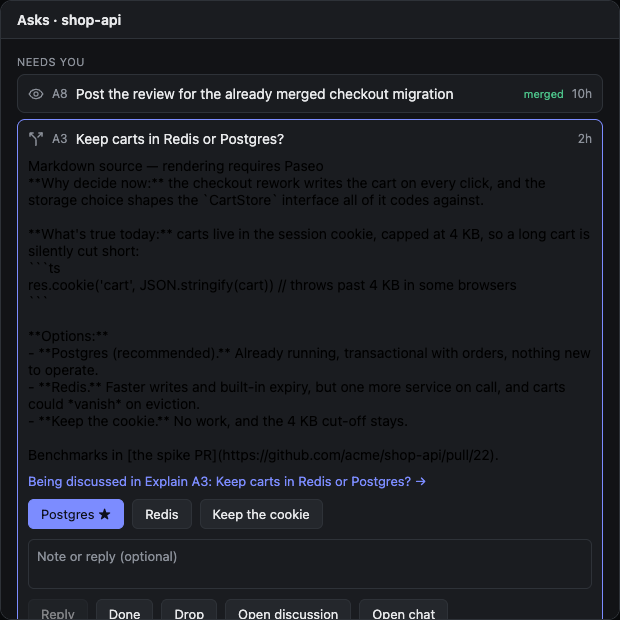
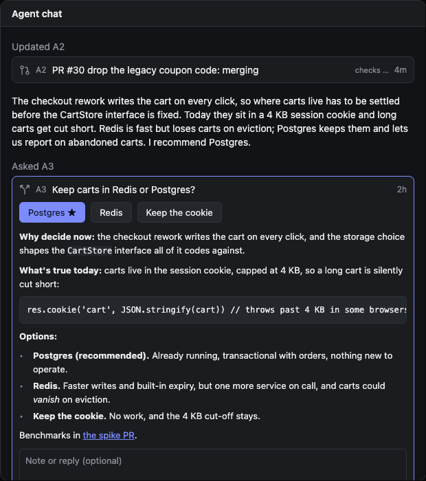

# Asks for Paseo

Asks is a [Paseo](https://paseo.sh) plugin. It lifts what your agents need from you out of their chats and into one list. When an agent needs a PR reviewed, a decision made, a follow-up approved or a manual step done, it records an **ask**. Each ask carries the buttons that answer it, and pressing one sends the answer back to the agent that raised it.

| Workspace panel, a decision with a markdown brief | Every workspace, on a phone, a PR ask expanded |
|---|---|
|  |  |



<sub>The screenshots render the plugin's own React Native components with sample data, using react-native-web (`preview/`). Inside Paseo they sit in its panel and screen chrome.</sub>

## What you can do with an ask

- **Pick an option.** A decision's options are buttons below the ask, and the agent's recommendation is the highlighted one. The agent gets `[asks] A3 resolved: b: squash-only`.
- **Hand work back.** A PR or follow-up offers actions such as "Merge (squash)". Pressing one sends the agent that exact instruction and shows the ask as *in progress*, with what you chose, until the agent closes it. An in-progress ask hides its buttons, so it goes back to waiting on you when the agent gives it new actions, when the agent is archived, or after a day with the agent not running. An agent whose turn ends while it holds an in-progress ask gets one reminder to reopen it if the next move is yours.
- **Reply.** The field under the buttons sends the agent your own answer (Enter on desktop). Text in it also goes along as a note with any button or menu item.
- **More (⋯).** *Mark done*, *Discuss*, *Show in chat* and *Drop ask*, in the host's menu (a bottom sheet on phones). Hosts without a plugin menu show them as text buttons.
- **Discuss.** Opens a workspace of its own for this one ask, titled *Explain A3: …*: a fresh worktree of the main agent's repo, branched off its default branch, with an agent on the main agent's model that already knows the ask and the main agent's latest reply. It starts by explaining the ask (with the `/explain` skill when installed: the short version with an example, what each option leads to, a recommendation), then takes your questions. It is told to write only in its own worktree (notes, figures) and to only read the main agent's checkout. It runs in the main agent's mode, so that is an instruction, not a sandbox. That workspace's Asks panel and pill list A3 too, with its buttons, so you can answer it right there; anything else the explainer needs from you becomes an ask of its own, numbered after A3. When you settle it in the chat, the explainer closes the ask and the main agent gets the outcome as one message: `[asks] A3 resolved in a side chat: … Summary: …`. A button you press there reaches the main agent as usual, and the explainer is told, so it does not settle the ask again. Meanwhile the ask shows *Being discussed in Explain A3: …*, which jumps there, and Discuss reopens it (pressing it twice while the workspace is being made still gives one). Once you have answered an ask, Discuss only reopens its existing discussion. Archiving the explainer, or the main agent reopening the ask, ends the discussion, and Discuss starts a new one. Where no workspace can be made (the main agent is not in a git repo), Discuss opens a read-only side chat in the ask's own workspace instead; it is not told to raise asks of its own, and is never reminded to.
- **Show in chat.** Opens the chat of the agent that raised the ask, scrolled to where it raised it (FSH hosts with `openAgent({ timelinePosition })`; elsewhere at the chat's end).
- **PR links open in the Inbox.** A GitHub PR link on an ask, and its PR status line, open that PR's review screen in [paseo-inbox](https://github.com/fullstackhouse/paseo-inbox); GitHub is a tap away from there. Without the Inbox, or on a host that can't open another plugin's screen (not the FSH build), they open GitHub. Links inside the ask's text still open GitHub.

PR asks show live status from `gh`: open, merged or closed, checks, review decision and conflicts, plus the head commit's preview deployments (GitHub Deployments with an environment URL, e.g. Vercel) as chips that open the preview when ready, or the logs while deploying or failed. An agent that subscribed to a PR ask is told when it merges, closes, its checks pass or fail, a preview becomes ready, or its review decision changes. While checks run, a PR ask can already carry a *Merge … when green* button: the agent merges once they pass, and fixes them first if they fail. To decide yourself when an agent works a review, turn off **Settings → Plugins → Asks → Tell agents about requested changes**: a reviewer requesting changes then raises an *Address review comments on PR #N* ask instead, and the agent starts only when you press its button. Agents are also told to leave requested changes to that ask; agents started or resumed before you change the setting keep the rules they started with.

## Where asks show up

- an **Asks** panel in each workspace, in the main area or the explorer (its **+** menu, or ⌘K: "Open asks for this workspace");
- an **Asks** screen in the sidebar, covering every workspace, with a count of what's waiting (asks in snoozed workspaces still list but leave the count);
- **inline in the agent's chat**, where it called `ask_create`, `ask_update` or `ask_resolve`: the tool row becomes the ask. The agent's latest call on an ask shows it live, open asks expanded with their buttons first, then the body; earlier calls show the ask as that call left it, read-only and folded (an update lists what it changed), so scrolling back reads as history (**Settings → Plugins → Asks** can fold the body behind a **Details** link). Agents are told to create the ask before their final reply, so the turn ends on their answer, which a collapsed turn keeps visible;
- a question-bubble pill in an agent's composer for that agent's own and relayed open or in-progress asks, hidden when there are none. Its label distinguishes waiting asks from in-progress work. Pressing it lists those asks with **Refresh asks**; on wide layouts **Open wide** opens the workspace Asks panel beside the chat.
  Relays can name asks from other workspaces; their rows show the workspace and answers still reach the owner. Only the newest relay batch starts expanded, including when two batches arrive in one millisecond. Completing that batch never expands an older one. Targets are validated together under workspace locks, and concurrent readers retain independent stamps without changing the ask's update time.
- on FSH Paseo desktop, a workspace summary item per workspace with asks (count, whether asks wait on you, and each waiting ask for the host's Overview; 0 when none wait). With the host setting **Entering a workspace opens the Explorer sidebar**, entering a workspace with a new waiting ask opens the Asks panel in Explorer. Hosts without `addWorkspaceSummaryItem` skip it.

## How it works

```
agent ──stdio MCP──▶ bridge.mjs ──HTTP 127.0.0.1──▶ plugin server ──▶ ~/.paseo/plugin-data/asks/
  ▲                    (inherits PASEO_AGENT_ID,                  │  workspaces/<id>.json, outbox.json
  │                     so every call knows its caller)           │
  └──── "[asks] …" message, steered into the turn or held ────────┘
```

- Every agent created after the plugin is installed gets an `asks` MCP server with `ask_create`, `ask_update`, `ask_resolve` and `ask_list`. Its instructions tell the agent when to use them, so no `CLAUDE.md` edit is needed.
- Agents sometimes ask in chat and skip `ask_create`. When a turn uses no asks tool and names none of its workspace's open asks (for an explainer, the ask it explains counts too), a short-lived child agent on the same provider (its cheapest model) judges whether the reply leaves anything for the human; if so, the plugin sends one `[asks]` reminder. If that check fails, a question mark in the last paragraph decides. A re-shown decision whose card id or title matches a scoped open ask is already recorded and skips the reminder. Its answer is never reminded again.
- Answers are written to an on-disk outbox first. On providers that take a steer (Claude, Codex, OpenCode, Pi), they join the agent's running turn right away. On others they wait until the turn ends, because a prompt sent mid-turn would interrupt it. Several answers are batched into one message. A plugin restart loses nothing.
- If the agent that raised an ask is archived, the ask is marked *orphaned*: you can still close it, and nobody is notified.
- Every Drop, Done, Reply or option press confirms who heard: the agent was told now, will be told when its current turn ends, or (orphaned) nobody. Acting on an ask that is already done or dropped fails with "A2 is already dropped; nothing was changed or sent", so a second press never re-sends. Each press, applied or refused, is one line in `act-log.jsonl` in the data folder.
- Ask ids count per workspace: "A2" in one workspace and "A2" in another are different asks with different owners.

## Status says whose move it is

An `open` ask waits on the human. An `in_progress` ask waits on the agent after the human hands work back. Running or idle turns do not flip the status: upstream's waiting-on-you lifecycle replaces the old local automatic run-state feature. Giving the ask new actions reopens it; upstream also reconciles abandoned in-progress asks.

The older auto-status design and result records remain historical evidence, not current behavior. See [the upstream catch-up decisions](docs/upstream-catch-up-2026-11.md).

## Install

Paseo 0.12 or newer, with plugins enabled on the daemon. `gh`, if installed in `/opt/homebrew/bin`, `/usr/local/bin` or `/usr/bin`, adds live PR status.

```bash
git clone git@github.com:fullstackhouse/paseo-asks.git
cd paseo-asks && npm install
paseo plugin install "$PWD"
paseo plugin ls            # paseo-asks should be "running"
```

Agents that already exist don't get the tools. Start a new agent.

## From a terminal

The plugin writes the port and token of its local listener to `~/.paseo/plugin-data/asks/server.json`, so scripts can do what the UI does:

```bash
S=~/.paseo/plugin-data/asks/server.json
P=$(jq -r .port $S); T=$(jq -r .token $S)
curl -s -H "authorization: Bearer $T" -X POST localhost:$P/act \
  -d '{"workspaceId":"wks_…","id":"A3","verb":"action","actionId":"a2"}'
curl -s -H "authorization: Bearer $T" -X POST localhost:$P/discuss -d '{"workspaceId":"wks_…","id":"A3"}'
# Relay asks to the agent whose reply pointed at them (the harness does this at turn end), in pointer order:
curl -s -H "authorization: Bearer $T" -X POST localhost:$P/relay \
  -d '{"readerAgentId":"agent-…","asks":[{"workspaceId":"wks_…","id":"A3"}]}'
```

## Develop

```bash
npm run typecheck      # client and server tsconfigs
npm test               # vitest: store, outbox, tools, discussions, PR watching
paseo plugin reload paseo-asks && paseo plugin logs paseo-asks
cd preview && npm install && npm run dev   # the UI with sample data, at localhost:5199
```


## Design decisions

- **Agents report asks themselves.** Nothing reads transcripts to find them: only the agent knows what it is waiting on.
- **Four fixed action kinds** (`send`, `resolve`, `open`, plus the built-in Discuss). Agents supply labels and prompts, never arbitrary behaviour.
- **One writer per checkout.** Work goes back to the main agent. A discussion is told never to touch its checkout (the fallback side chat is also read-only by mode) and ends with an outcome on the ask. Only the agent linked on the ask can act on it from another workspace.
- **Push, never interrupting.** Answers reach the agent as prompts from a disk outbox, steered into a running turn or held until it ends.
- **External events only if subscribed,** so polling `gh` never wakes an agent for nothing.

## Limits

- Lists refresh by polling (every 4 s, and every 8 s for pill counts). Paseo has no plugin channel for pushing updates to the app.
- An explainer's workspace stays after the ask is settled; archive it when you are done with it.
- The fallback side chat needs a provider with a read-only mode. Claude has `plan`; with any other provider, Discuss reports an error there.
- It's unverified whether agents created before a daemon restart keep the tools after it.
